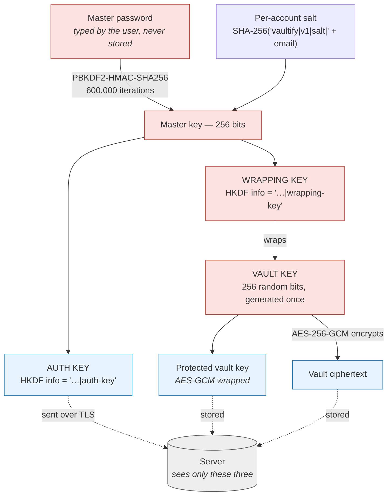

# Vaultify — Cryptographic Architecture

Status: all four weeks complete — crypto core, API, web client and hardening.

Everything in this document describes code that exists and is tested. Where a
decision is still open it says so, and the open items are listed in full at
[§7](#7-open-items).

The client's own design — the build, the CSP and SRI, auto-lock, conflict
merging, 2FA enrolment and the recovery kit — is in
[client.md](client.md); this document covers the cryptography and the
server-side model.

---

## 1. The one-sentence version

The master password never leaves the browser; the server stores a hash of an
auth key and an opaque ciphertext, and can do nothing with either.

---

## 2. Key hierarchy



Red = never leaves the device. Blue = crosses the network and is safe to store.

Plain-text fallback, for environments that do not render Mermaid:

```
                     master password  (user's head)
                            |
          salt  ----------> | PBKDF2-HMAC-SHA256, 600,000 iterations
                            v
                    master key (256 bits)
                       /            \
            HKDF "auth-key"      HKDF "wrapping-key"
                   /                    \
            AUTH KEY                WRAPPING KEY
          (to server)              (stays in browser)
                                          |
                                     wraps/unwraps
                                          v
                                    VAULT KEY (random 256 bits)
                                          |
                                    AES-256-GCM
                                          v
                                  vault ciphertext -> server
```

### Why two keys, not one

If the password were sent to the server to log in, the server would hold the
key to the vault, and "zero-knowledge" would be a slogan rather than a property.
Splitting the master key with HKDF under two different `info` labels produces
two values that are computationally independent: an attacker who takes the auth
key out of the database learns nothing about the wrapping key.

Implementation: `packages/crypto/src/kdf.ts`.
Test that pins the property: `test/kdf.test.ts` → *"the auth key reveals nothing
usable about the wrapping key"*.

### Why a separate vault key

The password-derived key does not encrypt the vault. It wraps a random 256-bit
vault key, which encrypts the vault. Two consequences:

- **Changing the master password is cheap and offline-safe.** Only the 32-byte
  wrapper is rewritten. The vault ciphertext is never downloaded, decrypted,
  re-encrypted, or re-uploaded — which also means a password change cannot
  corrupt or truncate the vault.
- **The long-lived secret is full-entropy.** The data is protected by 256 random
  bits. A human-chosen password only ever guards the wrapper, where the KDF
  work factor is doing its job.

Implementation: `packages/crypto/src/vault.ts`.

---

## 3. What the server actually stores

One row per account (`apps/api/src/store/schema.sql`):

```jsonc
{
  "accountId":         "ada@example.com",
  "authKeyHash":       "scrypt$32768$8$1$<salt>$<hash>",   // not the auth key
  "kdf":               { "algorithm": "PBKDF2", "iterations": 600000 },
  "protectedVaultKey": "1.AES-256-GCM.<iv>.<ct>",
  "vault":             "1.AES-256-GCM.<iv>.<ct>",          // null until first sync
  "vaultRevision":     4
}
```

Note `authKeyHash`, not `authKey`. The auth key is a bearer credential: anyone
holding it can download the (still encrypted) vault, which is exactly what 2FA
is there to backstop. So it is stored the way a password would be.

**Why scrypt and not Argon2id, as this document originally said.** Two reasons,
and one of them is an honest admission that the slow hash here is less load-
bearing than it first appears. The auth key is *not* a password — it is 256 bits
of PBKDF2 output, so an attacker holding the hash cannot brute-force it at any
speed. The real work factor is the 600,000 client-side iterations. Given that,
the deciding factor was operational: scrypt ships in Node's standard library,
so there is no native addon for every contributor to build, while Argon2id's
advantage against custom hardware does not apply to a full-entropy input. The
stored format is self-describing (`scrypt$N$r$p$...`), so switching later is a
migration, not a rewrite.

**KDF parameters are stored server-side** so the iteration count can be raised
without locking existing accounts out. That creates an obvious attack — a
compromised server telling the client to use 1 iteration — which is blocked in
three places: the client refuses anything below `PBKDF2_MIN_ITERATIONS`, the API
rejects it at validation, and the database has a `CHECK (kdf_iterations >=
100000)` constraint. A bug in any one layer does not weaken the KDF.

**The vault column is `TEXT`.** Unbounded in Postgres, so a growing vault cannot
be silently truncated the way `VARCHAR(n)` would truncate it — and a truncated
ciphertext is an unopenable vault, not a cosmetic defect. The application
enforces `MAX_VAULT_BYTES` on the way in; the integration suite stores a 2 MB
blob and reads it back byte for byte.

---

## 4. Sync and concurrency

The server stores one opaque blob per account and has no idea what is inside
it. That makes conflict handling unusually unforgiving: when two devices edit
the vault, the server cannot merge them, cannot diff them, and cannot even tell
that anything was lost. Last-write-wins would mean one device's new entries
vanish permanently, with no error anywhere.

So every write is a compare-and-set. The client sends the revision its edit was
based on; the server bumps the revision only if it still matches:

```sql
update accounts
   set vault = $2, vault_revision = vault_revision + 1, vault_updated_at = now()
 where account_id = $1 and vault_revision = $3
```

The check lives in the `WHERE` clause, not in JavaScript, so the compare and the
set are one atomic statement. A read-then-write would leave a window for two
concurrent syncs to both pass the check — `test/postgres.test.ts` races five
connections at the same row and asserts exactly one wins.

A losing client gets `409` with the current revision, re-reads, reapplies its
change over the newer vault, and retries. The merge happens on the client,
because the client is the only party that can read the data.

---

## 5. Choices and trade-offs

| Decision | Chosen | Alternative | Why |
|---|---|---|---|
| KDF | PBKDF2-HMAC-SHA256, 600k | Argon2id | Native in Web Crypto, so no WASM download on the login path. 600k is OWASP's 2023 figure. Argon2id is memory-hard and strictly better against GPU attack; `KdfParams.algorithm` exists so it can be added as a second path without a migration. |
| Salt | `SHA-256("vaultify\|v1\|salt\|" + email)` | Random, fetched before login | Deterministic means no "what is my salt?" endpoint, which would be a user-enumeration oracle. It is unique per account and domain-separated from every other service. It does *not* stop an attacker precomputing against one known target email — accepted, because 600k iterations makes that precomputation cost the same as just attacking the account directly. |
| Cipher | AES-256-GCM | AES-CBC + HMAC | One primitive, authenticated, hardware-accelerated. Tampering fails loudly instead of returning garbage — important when the storage layer is untrusted. |
| IV | 12 random bytes, fresh per encryption | Counter | Random is simpler and has no cross-device synchronisation problem. Reuse is the one catastrophic failure mode for GCM, so `cipher.test.ts` asserts 200 consecutive encryptions produce 200 distinct IVs. |
| Key handles | Non-extractable `CryptoKey` | Raw bytes in JS variables | An XSS can *use* a non-extractable key while the tab is open, but cannot export it and decrypt the vault offline afterwards. Limits the blast radius; does not eliminate it. |
| Context binding | Account id as GCM additional data | None | A malicious server cannot serve one user's blob to another, or swap wrapped key records between accounts. |
| Auth key storage | scrypt (N=2^15, r=8, p=1) | Argon2id | No native addon to build. The input is already full-entropy, so memory-hardness buys little here. Self-describing format allows a later switch. |
| Sessions | JWT + a session row checked per request | Stateless JWT | A stateless token cannot be revoked, so logout would be cosmetic and a password change could not sign other devices out. |
| Conflict handling | Optimistic concurrency, 409 on stale | Last write wins | The server cannot merge opaque blobs, so silent overwrite means invisible permanent data loss. |
| Account enumeration | `prelogin` returns defaults for unknown accounts; login runs a dummy scrypt | 404 / fast reject | Knowing which emails have vaults tells an attacker exactly who to phish. |

---

## 6. Threat model

### In scope — what Vaultify defends against

| Threat | Outcome |
|---|---|
| Database stolen / server breached | Attacker gets auth key hashes and ciphertext. No plaintext. To read one vault they must brute-force that user's master password at 600k PBKDF2 iterations per guess. |
| Malicious or compelled operator | Same position as the attacker above. The code that would have to change to capture plaintext is the client bundle, which is observable (see out-of-scope). |
| Network attacker | TLS, plus the vault is already encrypted underneath it. A MITM who strips TLS still sees ciphertext. |
| Tampered or swapped vault blob | GCM authentication fails; the client refuses the data rather than displaying altered entries. |
| Replaying another account's blob | Account id is authenticated as additional data — decryption fails. |
| Stolen auth key | Downloads an encrypted vault that is useless without the master password. With 2FA on, the download is blocked as well. |
| Weakened KDF parameters from the server | Client enforces `PBKDF2_MIN_ITERATIONS`. |
| Stolen session token | Downloads an encrypted vault, nothing more. Revocable: logout and password change kill it immediately, and it expires in 15 minutes. |
| Account enumeration | `prelogin` returns defaults for unknown accounts; login spends identical scrypt work either way. Registration is the one unavoidable exception, rate-limited to 5/hour. |
| Online password guessing | Rate limited per IP and per account, plus a per-account progressive lockout held in the database, on top of 600,000 client-side iterations per attempt. |
| Replayed TOTP code | Each step is accepted once. A code watched over someone's shoulder cannot be reused inside the 90 seconds it stays arithmetically valid. |
| Credential stuffing with a known-breached password | The client can check every stored password against Have I Been Pwned by k-anonymity, sending only a 5-character hash prefix. |
| Losing the master password | Not defended against — but a recovery kit taken at registration, plus an encrypted backup, reconstructs the *data* offline. It grants no account access. |
| Concurrent edits from two devices | Compare-and-set on a revision number. The stale write is rejected rather than silently destroying the other device's entries. |

### Out of scope — stated plainly

| Threat | Why not |
|---|---|
| Compromised client bundle | If the server ships malicious JavaScript, it can capture the master password as it is typed. This is the structural weakness of *all* web-delivered zero-knowledge apps. Mitigations are strict CSP, Subresource Integrity, and reproducible builds — they raise the cost and make the attack detectable; they do not make it impossible. A browser extension or native client is the real answer. |
| Malware / keylogger on the device | Out of reach of any web application. |
| Memory scraping of an unlocked tab | Auto-lock (Phase 3) shortens the window. JavaScript cannot guarantee key material is wiped — strings are immutable and the GC may have copied them. `encoding.zero()` is best-effort and documented as such. |
| Traffic analysis | The server learns when you sync and roughly how large your vault is. Not addressed. |
| Phishing | A convincing fake Vaultify can collect the master password. 2FA helps; user vigilance is the real control. |

### What 2FA does and does not change

Two-factor authentication is a layer on top of zero knowledge, not a hole in
it, and it is worth being precise because it is the one place the server holds
a secret it can actually use.

The server stores the TOTP seed in the clear and **can** generate valid codes
from it. That is unavoidable: the server is the party enforcing the second
factor, and it enforces it at login — before any vault key exists anywhere, on
any machine. Encrypting the seed under a key sitting in the same database would
be decoration.

What matters is the blast radius. An attacker who dumps the database gains the
ability to pass a 2FA prompt. They still face the same encrypted vault and the
same 600,000-iteration brute force, because the master password is not there
and never was. 2FA protects *account access*; the encryption protects the
*contents*, and the two do not depend on each other.

The honest summary:

| | Protects against | Does not protect against |
|---|---|---|
| Master password | Everything, ultimately — it is the only thing that derives the keys | Being forgotten |
| 2FA | Someone who has learned the master password reaching the vault blob | Anyone who already has the blob |
| Recovery kit | Losing access to the *data* | Losing access to the *account* |

### The question the brief asks: what if the user forgets the master password?

**The data is gone. Permanently. There is no reset link, and no support
channel can help.**

This is the system working, not failing. A recovery mechanism is, by
construction, a second way into the vault that does not require the master
password. Whatever form it takes — a server-held escrow key, security questions,
an emailed reset token — it hands the server, or anyone who compromises it, a
path to the plaintext. At that point the server *can* read your vault, and the
central claim of the product is false.

Every password manager faces this and the serious ones answer the same way. The
honest trade is: we cannot help you recover, and in exchange nobody can be
coerced, tricked, or breached into reading your vault.

What we do instead of a backdoor:

- Make the consequence impossible to miss at sign-up.
- Offer an exported **recovery kit** at registration — the vault key, printable,
  for the user to store offline. Possession stays entirely with the user.
  *(Implemented.)*

  Be precise about what it recovers. The kit is the vault key itself, generated
  once, shown once, and never derivable again by anyone including us. It
  decrypts a backup file. It is **not** a way to sign in: authenticating still
  needs the master password, so a found printout grants nothing on its own, and
  there is still no second path into the server's copy.

  So the promise is narrower than "recovery" usually implies, and it is the
  strongest one that does not reintroduce a backdoor: **kit + encrypted backup
  = your passwords back, offline, forever, even if this service no longer
  exists.** The UI pushes the backup download alongside the kit for exactly
  that reason — the kit alone opens nothing.
- Encourage a memorable high-entropy passphrase over a short complex password.

This is verified, not just asserted: `test/vault.test.ts` → *"there is no
recovery path, by design"*.

---

## 7. Open items

Done in Week 2:

- [x] Server-side hashing of the auth key — scrypt, never stored raw.
- [x] Rate limiting on the credential routes.
- [x] Revocable sessions; sign-out-everywhere on password change.
- [x] Optimistic concurrency on vault writes.
- [x] Security headers and strict CORS on the API.

Done in Week 3:

- [x] **CSP without `unsafe-inline` and SRI on the client bundle.** The one
      unavoidable inline element — the import map — is allowed by SHA-256 hash,
      and every module in the graph carries an integrity hash. See
      [client.md §2](client.md#2-the-build).
- [x] **Auto-lock**, on idle, on the tab being hidden, and at token expiry.
- [x] **Client-side conflict resolution.** The `409` path was specified in Week
      2 and is now implemented: a three-way merge against the last-synced
      state, biased so that no credential is ever silently lost.
      [client.md §5](client.md#5-sync-and-the-merge-the-server-cannot-do).
- [x] **No secret is persisted in the browser.** Locking is implemented as
      dropping the object that holds the keys.

Done in Week 4:

- [x] **TOTP 2FA** on the login route, with single-use steps and ten single-use
      recovery codes stored as scrypt hashes. Enabling requires a working code,
      and disabling requires the master password as well as a live session.
- [x] **Progressive lockout** per account, in the database, capped at 15
      minutes so it cannot be aimed at the account's owner.
- [x] **Audit logging** of logins and credential changes, surfaced to the user
      at `GET /api/auth/activity`. IPs are truncated and user agents reduced to
      a coarse label before storage.
- [x] **HIBP breach report** over k-anonymity, opt-in and per-run.
- [x] **Recovery-kit export**, with an encrypted backup and an offline restore
      that needs no account and no network.

Still open:

- [ ] **Redis-backed rate limiting.** The fixed-window counters are per-process
      today. The progressive lockout is in the database and does work across
      instances, so this is now a smaller gap than it was.
- [ ] **Argon2id as a second KDF path**, if the client can afford the WASM
      download on the login path.
- [ ] **Import-map integrity is Chromium-only** for now. The entry script's own
      `integrity` attribute is universal, but full-graph SRI is not enforced on
      Firefox or Safari yet.
- [ ] **Per-entry TOTP.** `VaultEntry.totpSecret` is defined and sealed with the
      vault, and `@vaultify/totp` already generates codes in the browser.
      Nothing reads the field yet.
- [ ] **Re-issuing recovery codes** without turning 2FA off and on again.
- [ ] **WebAuthn / passkeys** as a second factor, which would beat TOTP on
      phishing resistance and remove the server-held seed entirely.
- [ ] **Audit-log retention is enforced by a method nobody calls.**
      `pruneAuditEvents` exists; it needs a scheduled job behind it.
